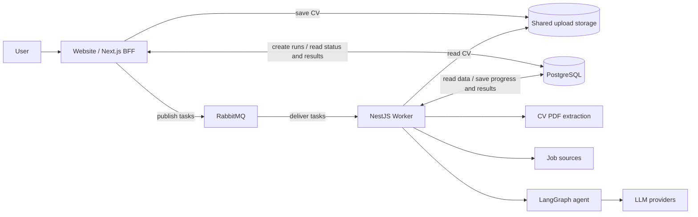
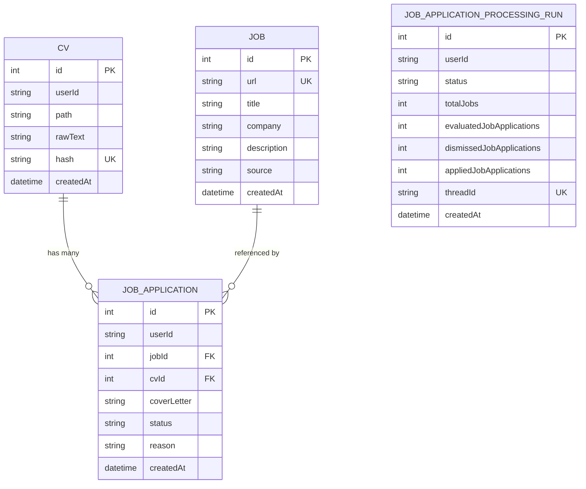
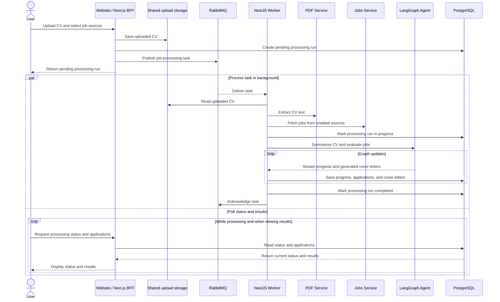
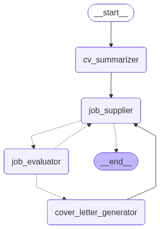

# Job Applicator

Job Applicator helps you discover jobs from multiple sources, evaluate how well your CV matches a role, and generate tailored cover letters.

## Prerequisites

- Node.js and npm installed locally.
- Docker running for the supporting services used by the backend and local development workflow.
- A populated `.env` file at the workspace root with the website, worker, database, queue, and model settings required by your environment.

## Set up for local development

1. Fill in `.env` file. Use `.env.example` as the starting point for the workspace `.env` file. This single file configures the whole application (website, worker, migrations, docker compose). Only the test modules (`apps/ai-evaluation`, `apps/website-e2e`) have their own `.env` files, see below.
1. Run `npm i` on root folder of the project.
1. Run `docker compose -f deployment/docker-compose.yml -f deployment/docker-compose.dev.yml --env-file .env --profile infrastructure --profile tools-reset up -d`. This will start all the necessary infrastructure and also recreates the database.
1. (Optional) Run `docker compose -f deployment/docker-compose.yml -f deployment/docker-compose.dev.yml --env-file .env --profile ai up -d` if you want to use nomic-embed-text-v2-moe Ollama model for embeddings.
1. Run `npm run dev-all` to start the website and worker.

## Required env vars

### Database

- `POSTGRES_HOST` - PostgreSQL host, usually `localhost` for local development.
- `POSTGRES_PORT` - PostgreSQL port, usually `5432`.
- `POSTGRES_USER` - Database user.
- `POSTGRES_PASSWORD` - Database password.
- `POSTGRES_DB` - Database name.

### Queue

- `RABBITMQ_URL` - RabbitMQ connection string, usually `amqp://localhost` for local development.
- `RABBITMQ_QUEUE_PROCESS` - (Optional) Queue name used for job-processing messages. Defaults to `job_application.process`.

### Website / Supabase

The following keys could be retrieved from your supabase project settings (https://supabase.com/dashboard/project/<your-project-key>/settings/api-keys).

- `NEXT_PUBLIC_SUPABASE_URL` - Supabase project URL used by the website auth flow.
- `NEXT_PUBLIC_SUPABASE_ANON_KEY` - Public Supabase anon key used by the browser and server clients.
- `NEXT_PUBLIC_SUPABASE_PUBLISHABLE_KEY` - Public Supabase publishable key used as an alternative to the anon key.
- `NEXT_PUBLIC_APP_URL` - Public URL of the website (e.g., `http://localhost:3000` for local development).

For the website, `NEXT_PUBLIC_SUPABASE_URL` must be available when the Docker image is built so the browser bundle can embed it. You can provide either `NEXT_PUBLIC_SUPABASE_ANON_KEY` or `NEXT_PUBLIC_SUPABASE_PUBLISHABLE_KEY`, and the app will use whichever one is set.

### AI & Models

- `OLLAMA_EMBEDDING_MODEL` - (Default) Model name for generating embeddings with Ollama (e.g., `nomic-embed-text-v2-moe:latest`).
- `OLLAMA_EMBEDDING_BASE_URL` - (Optional) Base URL for the Ollama embedding API.
- `OLLAMA_JOB_EVALUATOR_MODEL` - Ollama model name used to evaluate whether a job matches the CV.
- `CV_PARSER_MODEL` - Ollama model name used to parse the CV.
- `COVER_LETTER_GENERATOR_MODEL` - Ollama model name used to generate the cover letter.
- `CRITIQUE_MODEL` - Ollama model name used to critique and rewrite the cover letter.
- `OLLAMA_BASE_URL` - Base URL for the Ollama API (e.g., `http://localhost:11434`).
- `OLLAMA_API_KEY` - (Optional) API key for Ollama if running behind an authenticated proxy.

### Storage

- `STORAGE_DIR` - Path to the directory where CVs and uploads are stored.

### Other

- `ENABLE_QUERY_LOG` - Set to `true` to enable TypeORM query logging (default: `false`).

## Optional but supported

### Cohere Configuration

If `COHERE_API_KEY` is set, the app can use Cohere models instead of Ollama for generating embeddings.

- `COHERE_API_KEY` - Cohere API key.
- `COHERE_EMBEDDING_MODEL` - (Optional) Model name for generating embeddings with Cohere (default: `embed-v4.0`).

### Gemini Configuration

If `GEMINI_API_KEY` is set, the app can use Gemini models instead of Ollama for supported tasks.

- `GEMINI_API_KEY` - Google Gemini API key.
- `GEMINI_CV_PARSER_MODEL` - Gemini model for CV parsing (Default: `gemini-3.1-flash-lite-preview`).
- `GEMINI_JOB_EVALUATOR_MODEL` - Gemini model for job evaluation (Default: `gemini-3.1-flash-lite-preview`).
- `GEMINI_COVER_LETTER_GENERATOR_MODEL` - Gemini model for cover letter generation (Default: `gemini-3.1-flash-lite-preview`).
- `GEMINI_CRITIQUE_MODEL` - Gemini model for cover letter critique (Default: `gemini-3.1-flash-lite-preview`).

### LangSmith Tracing

- `LANGSMITH_PROJECT` - LangSmith project name for tracing.
- `LANGSMITH_TRACING` - Set to `true` to enable LangSmith tracing.
- `LANGSMITH_API_KEY` - LangSmith API key.

### NewRelic log ingestion

- `NEWRELIC_LICENSE_KEY` - New Relic license key for APM.
- `NEWRELIC_OTLP_ENDPOINT` - New Relic OTLP endpoint. Default to EU.

### Other

- `NODE_ENV` - Environment mode (`development`, `production`, `test`). Defaults to `development`.
- `SKIP_ENV_VALIDATION` - Set to `true` to bypass environment variable validation (useful for builds).

## Run Tasks

### Run all

Start the full workspace with:

```sh
npm run dev-all
```

This runs the Nx development targets for the workspace apps together.

### Run frontend website

Start only the Next.js app with:

```sh
nx dev website
```

### Run worker

Start only the NestJS worker with:

```sh
nx serve worker
```

The worker consumes job-processing messages from RabbitMQ, executes the LangGraph workflow, and persists the generated cover letters and processing status in PostgreSQL.

### Run Tests

Run the full workspace test suite from the workspace root with:

```sh
npm test
```

This runs every Nx `test` target in the repository, including the worker integration tests.

Run only unit tests from the workspace root with:

```sh
npm run test:unit
```

This runs every Nx `test` target while ignoring `integration.spec.ts` files.

Run the worker integration test suite from the workspace root with:

```sh
npm run test-integration:worker
```

This runs the Nx Jest target for `apps/worker` and picks up the `*.integration.spec.ts` files under `apps/worker/src/`.

The current worker integration test coverage is the CV embedding integration spec, so make sure local Ollama is running and these models/configurations are available:

- `OLLAMA_BASE_URL` - should point to your local Ollama server, usually `http://localhost:11434`.
- `OLLAMA_EMBEDDING_MODEL` - embedding model (default `nomic-embed-text-v2-moe:latest`).
- Either `GEMINI_API_KEY` or a local Ollama model configured in `CV_PARSER_MODEL` (e.g., `gemma3:4b-cloud`) for CV parsing.

### End-to-end tests

End-to-end tests live in `apps/website-e2e/` and run with Playwright.

Run the e2e test suite from the workspace root with:

```sh
npm run test:e2e
```

This runs the full Playwright suite against the Next.js website in headless Chrome.

E2E tests are a standalone test module with credentials separate from the application. Copy `apps/website-e2e/.env.example` to `apps/website-e2e/.env` and fill it in; values from the workspace root `.env` are loaded first and this file overrides them.

The e2e setup uses a dedicated `SUPABASE_SECRET_KEY` to create and tear down a test user with `email_confirm: true`, so tests can log in without email verification.

Required for e2e tests:

- `NEXT_PUBLIC_SUPABASE_URL` - Supabase project URL.
- `NEXT_PUBLIC_SUPABASE_PUBLISHABLE_KEY` or `NEXT_PUBLIC_SUPABASE_ANON_KEY` - public Supabase key.
- `SUPABASE_SECRET_KEY` - **service-role / secret key** used by the test setup to create the test user.

The e2e job also runs in GitHub Actions (see `.github/workflows/e2e.yml`) in parallel with unit and integration tests.

## AI Evaluation

The `apps/ai-evaluation/` app contains LangSmith-based evaluation scripts for the job evaluator and graph flows.

Run them from the workspace root:

```sh
npm run ai-eval:node-job-evaluator
npm run ai-eval:graph
```

Each command seeds its dataset if needed and then runs the matching `eval.ts` file.

The eval app is a standalone test module with credentials separate from the application. It reads its own config from `apps/ai-evaluation/.env` (see `apps/ai-evaluation/.env.example`), which overrides values from the workspace root `.env` loaded through the shared env loader.

Required for the eval app:

- `GRADER_LLM_MODEL` - model used to score graph evaluation output.

Optional for the eval app:

- `GEMINI_API_KEY` - required when the grader model is a Gemini model.
- `OLLAMA_BASE_URL` - required when the evaluator graph uses Ollama.
- `SKIP_ENV_VALIDATION=true` - bypasses env validation for local scripting.

## Database Migrations

Run the TypeORM migration from the workspace root with:

```sh
npm run migrate
```

This uses the migration datasource at `libs/migrations/src/migration-data-source.cjs` and applies migrations from `libs/migrations/src/scripts/`.

If you need to wipe the local schema and rebuild it from migrations, run:

```sh
npm run db:reset
```

This drops every table in the `public` schema and then reruns migrations.

## Used Technologies

- **Nx** for monorepo orchestration and task execution.
- **Next.js** for the website frontend and backend for frontend (BFF).
- **NestJS** for the worker and message-driven job processing.
- **React** and **TypeScript** for the UI layer.
- **Tailwind CSS** for styling.
- **PostgreSQL** with **TypeORM** for persistence.
- **RabbitMQ** with `amqplib` for asynchronous job processing.
- **LangChain** and **LangGraph** for the AI agent workflow.
- **Jest** and **Playwright** for automated testing.

## Project Architecture

The repository is organized as an Nx monorepo:

- `apps/website/` contains the Next.js UI and BFF. Its route handlers access PostgreSQL directly and publish processing requests to RabbitMQ.
- `apps/worker/` contains the NestJS worker that consumes RabbitMQ messages, processes job data, runs the agent workflow, and persists results in PostgreSQL.
- `apps/website-e2e/` contains Playwright end-to-end tests.
- `libs/shared/` is available for reusable workspace utilities.
- `libs/migrations/` contains TypeORM migrations and the migration datasource.

### Component Diagram

The Next.js website acts as a BFF: it stores uploaded CVs, creates processing runs in PostgreSQL, and publishes tasks directly to RabbitMQ. The worker consumes those tasks, fetches job listings, reads the uploaded CV, runs the AI workflow, and saves progress and applications to PostgreSQL. The website reads status and results directly from the database.



### Entity Relationship Diagram

Note: Entities also contains userId, which is an ID of the user saved in Supabase Auth.



### Sequence Diagram

1. The user submits a CV file and processing preferences to the Next.js BFF.
2. The BFF stores the CV, creates a pending processing run in PostgreSQL, publishes a task to RabbitMQ, and returns the run to the user.
3. The worker consumes the task, extracts text from the uploaded CV, and fetches jobs from enabled sources.
4. The LangGraph agent summarizes the CV, evaluates each job, and generates cover letters for matching roles. The worker saves progress and results in PostgreSQL.
5. The website polls its BFF routes, which read processing status and applications directly from PostgreSQL.



## AI Agents

The AI workflow is implemented with LangGraph in `apps/worker/src/app/ai/langgraph/`.



The main graph works as follows:

- `cv_summarizer` reduces the uploaded CV into a compact summary optimized for downstream evaluation.
- `job_supplier` iterates through the fetched jobs one by one.
- `job_evaluator` checks whether the current job is a meaningful match for the candidate.
- `cover_letter_generator` creates a tailored cover letter for matched jobs.
- `CoverLetterGraph` adds a critique-and-rewrite loop so the generated letter is refined before it is stored.

The graph keeps track of how many jobs have already been processed and stops once it reaches the configured maximum.

## Production deployment

### Docker

The Docker setup is split into two compose files:

- [`deployment/docker-compose.yml`](deployment/docker-compose.yml) for production and GitHub Actions deploys. It uses published images only.
- [`deployment/docker-compose.dev.yml`](deployment/docker-compose.dev.yml) for local development. It adds build contexts for the locally built images, including `ollama`, `worker`, `website`, `db-reset`, and `db-migrate`.

The production compose file expects a `.env` file next to `deployment/docker-compose.yml`. That file should contain the runtime settings for the stack, including the public Supabase values used by the website image build.

#### Run locally

Start the infrastructure plus resetting the db with:

```sh
docker compose \
  -f deployment/docker-compose.yml \
  -f deployment/docker-compose.dev.yml \
  --env-file deployment/.env \
  --profile infrastructure \
  --profile tools-reset \
  up -d --build postgres db-reset db-migrate
```

If you only want the reset flow, run:

```sh
docker compose \
  -f deployment/docker-compose.yml \
  -f deployment/docker-compose.dev.yml \
  --env-file deployment/.env \
  --profile infrastructure \
  --profile tools-reset \
  up -d --build postgres db-reset
```

To run the app stack together with the OpenTelemetry Collector in local development, include the `app` and `observability` profiles:

```sh
docker compose \
  -f deployment/docker-compose.yml \
  -f deployment/docker-compose.dev.yml \
  --profile infrastructure \
  --profile app \
  --profile ai \
  --profile observability \
  up -d --build
```

The local collector tails the shared `logs/` volume, so Pino writes structured logs to `/app/logs/app-json.log` and OTel forwards them to the configured exporter.

#### Run in production

After GitHub Actions builds and pushes the images, the deploy host should use the compose file directly:

To start the full stack with an empty database and profile intended for a fresh state, run:

```sh
docker compose -f deployment/docker-compose.yml --env-file deployment/.env --profile "*" up -d
```

To start the normal stack using the persisted database and configuration, run:

```sh
docker compose -f deployment/docker-compose.yml --env-file deployment/.env --profile app --profile infrastructure up -d
```

To include the OpenTelemetry Collector in production, add the `observability` profile as well:

```sh
docker compose -f deployment/docker-compose.yml --env-file deployment/.env --profile app --profile infrastructure --profile observability up -d
```

In production, the app services log to stdout and Docker writes those logs under `/var/lib/docker/containers`, which the collector tails and forwards.
PostgreSQL data is stored in the named Docker volume `postgres_data`, so `docker compose down` keeps the database unless you explicitly remove volumes.

To run the database tool containers in production, use the image-based services:

```sh
docker compose -f deployment/docker-compose.yml --env-file deployment/.env --profile infrastructure --profile tools-reset up -d postgres db-reset
docker compose -f deployment/docker-compose.yml --env-file deployment/.env --profile infrastructure --profile tools-migrate up -d postgres db-migrate
```

To stop all the docker containers, run the following command:

```sh
docker compose -f deployment/docker-compose.yml --env-file deployment/.env --profile "*" down
```

To build a docker container for the worker, run the following command:

```sh
docker build --no-cache --progress=plain -f apps/worker/Dockerfile -t job-applicator-worker:latest .
```

To build a docker container for the website, run the following command:

```sh
docker build --no-cache --progress=plain -f apps/website/Dockerfile --build-arg NEXT_PUBLIC_SUPABASE_URL="$NEXT_PUBLIC_SUPABASE_URL" --build-arg NEXT_PUBLIC_SUPABASE_ANON_KEY="$NEXT_PUBLIC_SUPABASE_ANON_KEY" --build-arg NEXT_PUBLIC_SUPABASE_PUBLISHABLE_KEY="$NEXT_PUBLIC_SUPABASE_PUBLISHABLE_KEY" -t job-applicator-website:latest .
```

To run the website in a docker container, use the command below. Note that the container requires several environment variables (such as `STORAGE_DIR`, `RABBITMQ_URL`, and `POSTGRES_*`) to boot correctly. It is recommended to use an `--env-file` or prefer running via the `docker-compose.yml` file as the standalone `docker run` will not boot as-is without these variables:

```sh
docker run -d -p 3000:3000 job-applicator-website:latest
```

Here are some useful commands for postgres in docker container:

```sh
# you can change the db password using the following command
docker exec -it job-applicator-postgres-1 psql -U postgres -d job_applicator -c "ALTER USER postgres WITH PASSWORD 'postgres';"

# retest that user is working with the new password

docker run --rm -it --network job-applicator_default pgvector/pgvector:pg18 sh -lc 'PGPASSWORD=postgres psql -h postgres -U postgres -d job_applicator -c "select current_user, current_database();"'

# to execute a sql query
docker exec -it job-applicator-postgres-1 psql -U postgres -d job_applicator -c "SELECT * FROM public.job_application;"
```

## Observability

The project uses an OpenTelemetry-based observability pipeline that runs alongside the application services via Docker Compose.

### Architecture

- **OpenTelemetry Collector** (`otel-collector`): Runs as a Docker service (profile `observability`) using the `otel/opentelemetry-collector-contrib` image.
- **Configuration**: The collector is configured via two mounted YAML files:
  - `observability/otel-collector-config.base.yaml` — base pipelines and New Relic exporter.
  - `observability/otel-collector-config.local.yaml` — local overrides that add a `debug` exporter for verbose console output.

### Pipelines

| Signal  | Receivers           | Processors | Exporters                                 |
| ------- | ------------------- | ---------- | ----------------------------------------- |
| Traces  | `otlp` (HTTP 4318)  | `batch`    | `otlphttp/newrelic` (and `debug` locally) |
| Metrics | `otlp` (HTTP 4318)  | `batch`    | `otlphttp/newrelic` (and `debug` locally) |
| Logs    | `otlp` + `file_log` | `batch`    | `otlphttp/newrelic` (and `debug` locally) |

- **OTLP HTTP receiver** is exposed on port `4318` for applications to push traces, metrics, and logs directly.
- **File log receiver** tails JSON log files from the shared `logs` volume (`${LOGS_DIR}/*.log` locally, or `*-json.log` in production).

### Application Logging

Applications use `createLogger()` from `@apps/shared`, which wraps [Pino](https://getpino.io/). In development mode, logs are written as structured JSON to `logs/app-json.log` and pretty-printed to stdout when running in a TTY. The log volume is mounted into both the application containers and the collector so logs can be scraped automatically.

### Production

In production, the collector is reconfigured to read Docker container logs directly from `/var/lib/docker/containers` (read-only mount). It sends all telemetry to New Relic using the OTLP HTTP endpoint (`https://otlp.eu01.nr-data.net` by default) with the `NEWRELIC_LICENSE_KEY` environment variable.
