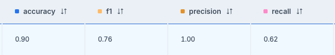
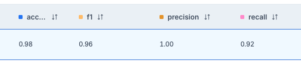

# Improvements after Evaluation 1

After [the first evaluation](001-eval.md) I got a baseline and candidate models I would like to focus on. I picked 2 models:

- `baseten/elephant-1` - this model had 82% accuracy in the first evaluation and costs only $0.04 per 1M input token (output token is free). Also, the latency was per request for P99 was between 0,5 - 0,7 seconds.
- `google/gemma-4-31b-it` - this model had 90% accuracy in the first evaluation and costs only $0.14 / $0.40
  per 1M. Additionally, it is an open-weight model by Google. The only concern I have now is the latency that is 14,22s for P99. That might be a glitch during test, but it is something that needs to be verified further.

> Note: For these improvements I have to change LangSmith account and reran some tests again as I have a free account, and it was out of free credits. So the links and runs are different from the ones in the Evaluation 1.

## Improving baseten/elephant-1

### Step 1

First session: https://eu.smith.langchain.com/public/49fd7e0a-d6fa-4632-9c6e-e5807134f594/d/compare?selectedSessions=3f4d28b8-7459-4faf-b447-216d24c91f54

In the code to calculate matching job I have [this condition](../../worker/src/app/ai/job-evaluator/jev/job-fit.decision.ts):

```js
const MIN_LEVEL_SCORE = 1.5;

if (answers.roleMatch.score < MIN_LEVEL_SCORE) {
  return {
    kind: JobEvaluationDecision.DISMISS,
    fit,
    reason: 'role_mismatch',
  };
}
```

Role match is defined by [this score question](../../worker/src/app/ai/job-evaluator/jev/job-fit.questions.ts):

```
role_match: {
    type: 'score',
    instructions:
      'How closely does the role described in `job` match the work the candidate has done, as shown in `candidate`?',
    levels: [
      {
        label: 'different_profession',
        description:
          'The job is a different profession from every role the candidate has held, for example a sales or design role for a software engineer.',
      },
      {
        label: 'neighbouring_field',
        description:
          'The job is in a neighbouring field, for example a DevOps or data engineering role for a backend developer.',
      },
      {
        label: 'same_role_other_stack',
        description:
          'The job is the same kind of role the candidate has held, but built on a different main technology stack.',
      },
      {
        label: 'same_role_same_stack',
        description:
          'The candidate has held the same kind of role on the same main technology stack.',
      },
    ],
  },
```

This means that if the role is `different_profession` or more `neighbouring_field` than `same_role_other_stack`, it will be automatically dismissed. This could dismiss cases like when the processed CV has enough qualifications for the job, but never worked in the field before. This should be taken into account and potentially apply for this job.

#### Example

I will explain the findings [on one example from the run](./002-eval/example-1.json). We have a job ad

```
https://www.startupjobs.cz/nabidka/108845/obchodnik-v-it-firme-diky-vysokym-marzim-softwaru-vydelavej-az-150k-s-moznosti-remote
Sales Representative at an IT Company

We welcome both junior and experienced salespeople. Your mindset matters more than your CV.

We're a young team and want to work with people who are on the same wavelength.

Active in sports. You don't have to be a pro, but sports need to be part of your life. We all play sports here too. 💪

Ambitious and resilient. Sales isn't for everyone. You need to be able to handle rejection.

A good communicator. You're comfortable picking up the phone, sending a message, and going to meetings.

Some sales experience is a plus. Even a part-time retail job counts, but a willingness to learn matters most.
```

and the shortened [CV](../src/node-job-evaluator/data/cvs.ts#L111)

```
Summary: I'm an open-minded, motivated team player who works well independently, enjoys meeting people and learning new skills, and loves sports and travel.


Experiences:
CETIN (Business Intelligence Analyst) — Administered Microsoft Fabric, built a Python-based data warehouse framework in Databricks, and developed Power BI reports.

Awsbi.com (Awesome Business Intelligence) — Teaches practical Power BI and Microsoft Fabric skills on YouTube.

dolphin consulting (Business Intelligence Consultant) — Built Power BI models and dashboards for MSD and Organon, streamlined tax workflows with Power Apps and Dataverse, and trained Power BI users.

con4PAS, a.s. (SAP C4C Consultant) — Delivered SAP CRM implementations from requirements analysis to go-live, working directly with customers and training their teams.

4P&P, spol. s. r. o. (Sales Promotion) — Promoted products through tastings, sampling, presentations, events, competitions, roadshows, and outdoor sales.
```

You could see that the person has enough required experience to work on this position. He/she just never worked on similar position before.

System one model evaluated core requirements like this

```
"core_requirements": {
  "confidence": 0.41860931893071984,
  "probabilities": [
    {
      "label": "none",
      "probability": 0.041193077332883465,
      "value": 0
    },
    {
      "label": "few",
      "probability": 0.20850646049883528,
      "value": 1
    },
    {
      "label": "most",
      "probability": 0.4598023962636032,
      "value": 2
    },
    {
      "label": "all",
      "probability": 0.29049806590467797,
      "value": 3
    }
  ],
  "score": 1.9996054507400758,
  "type": "score"
},
```

and role match

```
"role_match": {
  "confidence": 0.2236074989126735,
  "probabilities": [
    {
      "label": "different_profession",
      "probability": 0.5221651957234542,
      "value": 0
    },
    {
      "label": "neighbouring_field",
      "probability": 0.23204065858819375,
      "value": 1
    },
    {
      "label": "same_role_other_stack",
      "probability": 0.19303059456592309,
      "value": 2
    },
    {
      "label": "same_role_same_stack",
      "probability": 0.05276355112242885,
      "value": 3
    }
  ],
  "score": 0.7763925010873265,
  "type": "score"
},
```

According to the model, the CV has `most` of `core_requirements`, but the `role_match` is `different_profession`.

#### Change

The change was following:

```
const STRONG_CORE_MATCH_PROBABILITY = 0.75;

const hasStrongCoreMatch =
    mostCoreRequirementsProbability + allCoreRequirementsProbability >= STRONG_CORE_MATCH_PROBABILITY;

if (isRoleMismatch && !hasStrongCoreMatch) {
    return {
      kind: JobEvaluationDecision.DISMISS,
      fit,
      reason: 'role_mismatch',
    };
  }
...
  if (isRoleMismatch) {
    // the person never worked in this kind of role before,
    // but has most or all the required skills
    return {
      kind: JobEvaluationDecision.UNCERTAIN,
      fit,
      reason: 'role_mismatch_with_strong_core_match',
    };
  }
```

Now it is taken into account the fact that role does not match the CV, but the model thinks there is strong match in core requirements. The number 0.75 (75% probability) is taken from the first session so that the most cases will pass.

#### Result

The run after I made those changes in code: https://eu.smith.langchain.com/public/49fd7e0a-d6fa-4632-9c6e-e5807134f594/d/compare?selectedSessions=b247cd0b-c0fe-47cc-8b38-2ee3cd16b96e

**4 wrong evaluations were fixed by this change. Accuracy changed from 0.82 to 0.9. Recall changed from 0.31 to 0.62 while Precision stays the same 1.00.**

### Step 2

Second session: https://eu.smith.langchain.com/public/49fd7e0a-d6fa-4632-9c6e-e5807134f594/d/compare?selectedSessions=b247cd0b-c0fe-47cc-8b38-2ee3cd16b96e

Now I have already 90% accuracy. That is very high and the jobs that were wrongly evaluated are actually uncertain even for human. However, in such cases it is better if the job is chosen and applied. Therefore, my next goal is to increase recall even for the price of decreasing precision a bit.

Currently, the recall is 0.62. To analyze this, I had a look at the 5 jobs that were wrongly evaluated. 3 of them has no real blocker, the candidates have required skills and the job are open to juniors as well. The only problem is that the core match was not as high I set in the previous step with 75%. If I set it to 48%, those 3 would pass.

The other 2 jobs were not passed because the blockers were not fulfilled. [One](../src/node-job-evaluator/data/cases.ts#250) specifically requires Czech (`Výborně komunikuješ česky`) language and the CV doesn't mention anything (note: I know the person, and she doesn't speak Czech at all, but I will not take this into consideration here). [The other](../src/node-job-evaluator/data/cases.ts#L194) requires `1–3 years of experience in operations, PMO, project coordination, reporting or sales/revenue operations, ideally in a B2B SaaS or professional services environment.` and the candidate doesn't have these experiences specified in the CV. I will try to address these issues in the next step.

#### Change

I tried to decrease STRONG_CORE_MATCH_PROBABILITY to 48%. From the previous check, it was the lowest number I need to decrease in order to make the right jobs to pass.

#### Result

The run after I decrease the probability: https://eu.smith.langchain.com/public/49fd7e0a-d6fa-4632-9c6e-e5807134f594/d/compare?selectedSessions=f8e17af4-7303-495b-9883-642dbab957e4

As expected, the 3 jobs are now correctly evaluated. However, I also got 3 new wrong evaluations. This happens because they were correctly evaluated as dismiss, and now since I lower STRONG_CORE_MATCH_PROBABILITY, they are evaluated as uncertain. This is a trade-off I have to do if I want to have higher recall, but I will try tackle this in the next steps. Accuracy remains the same at 90%.

### Step 3

I decided that Decision model is already well tuned and further tuning might not bring so much value. In this step I focus on tuning LLM.

This is the baseline for LLM: https://eu.smith.langchain.com/public/49fd7e0a-d6fa-4632-9c6e-e5807134f594/d/compare?selectedSessions=7442b280-6f82-4878-90f2-83f666231687

The accuracy is already high at 90%. However, the recall is quite low and I would like to improve that.


The main focus is on the prompt as the original prompt was just created by another LLM and was not really tuned. To tune it, I need the LLM to return rationale why it considers the particular CV/job match as apply or dismiss, as right now it returns only true/false depending on if the candidate should apply or not.

For those wrongly evaluated jobs, LLM was assuming that the candidates were overqualified, or the salary expected by the candidate might be higher than the job (though it was only assumed by the roles, not the numbers). And also there was the language mismatch, the same problem that appeared in Jev evaluation. The job explicitly requires a spoken language, but that language is not stated in the CV.

#### Change

I added the following rules to the prompt:

```
- Count experience or seniority above the required level as meeting that requirement.
- Do not infer salary expectations, lack of interest, boredom, or risk of early departure from the candidate's experience, qualifications, or seniority.
- If the posting offers an alternative to prior experience, evaluate that route on its own terms. Use concrete accomplishments in related work as evidence. A different title or career path is insufficient grounds for rejection.
- When the employer requires hands-on experience in a specific activity, look for evidence of doing that work at the required level. A tool in the skills list or years in an adjacent profession alone cannot establish that experience.
- When the CV demonstrates the main work at the required level and the only gap is one supporting tool or method, return true.
- Assess only the languages the employer explicitly requires. The language of the posting, the customer market and the location of the role do not establish an additional language requirement.
```

#### Result

After adding the missing rules, the recall jumps from 62% to 92%. Also, accuracy was improved from 90% to 98%.
https://eu.smith.langchain.com/public/49fd7e0a-d6fa-4632-9c6e-e5807134f594/d/compare?selectedSessions=148c5538-c190-4a49-9e8e-28621629abd0


